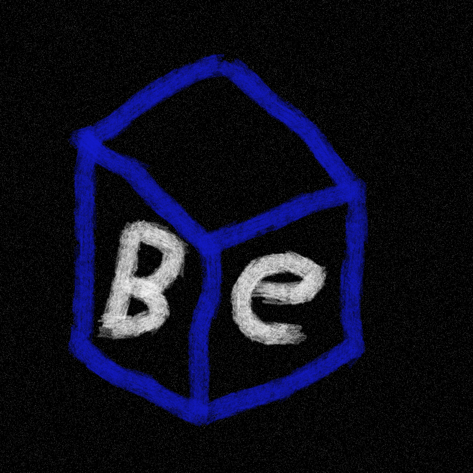

# BlueEngine, a simple 3D Python Engine.
<table align="right">
  <tr>
    <td>
      
    </td>
  </tr>
  <tr>
    <td align="center">
      (Art by betrayedreaper)
    </td>
  </tr>
</table>
<br>

By SrRotiehc, 2026.
To instructions on how to install, please check the bottom of the readme at "compile", also have in mind that all the functions and instructions on this readme will always correspond to the latest version.

Latest Version:
V0.15 (Erl King)

Developing:
V0.20 (宇宙ステーションのレベル7)

(This is a experimental version with LOTS of resources missing)

```python
import BlueEngine as be    # the python version of the .so must be the same as the one used, the .so also needs to be in the same folder as the project, it is recommended to not rename the .so
```
## Window and Loop

| Function | Description |
|---|---|
| `start(width=1600, height=800, title="Blue Engine", resizable=False)` `*` | Create the window and the context alongside with other basic parameters, it will give an error if it's called twice. With `resizable=True` the player can resize the window and switch fullscreen on and off with `F11` or `Alt`+`Enter` (the drawing adapts to the size of the window by itself, and the script still receives those keys). It needs a driver with OpenGL 3.3. |
| `quit()` `*` | Closes the window and clear the cache, can be called twice even though it is not recommended. |
| `running()` → `bool` `*` | `True` Function that checks if the instance is running, will return true if so unless the player closes the window (X, Alt F4...) or `stop()`/`quit()` are called. |
| `stop()` `*` | Ask to stop (`running()` becomes `False`). |
| `windowTitle(title)` | Changes the window title. |
| `deltaTime()` → `float` `*` | Seconds between the last two frames (the last two `flip()`), limited to 0.1s. The first frame uses 1/60. |
| `setFPS(fps=None)` | Limits the frame rate: a number = limit in frames per second, `0` = no limit, no value = the default (vsync, the monitor refresh rate). With a number or `0` the vsync is turned off. It can be called before or after `start()`. Text or `True`/`False` → `TypeError`, a negative number, `nan` or `inf` → `ValueError`. |
| `gpuName()` → `str` | Name of the GPU that OpenGL is really using, for example `"NVIDIA GeForce RTX 3060/PCIe/SSE2"`. Something like `llvmpipe` means that the CPU is drawing instead of a graphics card. It needs `start()` first (`RuntimeError`). |
| `setGPU(index=None)` `*` | Lists the GPUs of the computer and chooses the one that the engine uses: `setGPU()` uses the system default, `setGPU(n)` uses the GPU number `n`. It always returns the list of GPUs, so `print(setGPU())` shows them numbered, with the default and the chosen one marked. It must be called **before** `start()` (after it, only the listing works and a number gives `RuntimeError`). A number that is not a GPU → `ValueError`, not an integer (or `True`/`False`) → `TypeError`. Linux only for now (the GPUs are read from `/sys/bus/pci`; if none is found the list is empty and the system default is used). |
| `ver()` `*` | Prints the version of the engine and of what it depends on (Python, pybind11, SDL2, OpenGL, numpy, Pillow and the C++ compiler used to build it). It works before `start()` too, but the OpenGL line only shows up after it (it needs the window). |

## Inputs

The inputs are updated by themselves: `flip()` reads the keyboard, the mouse and the closing of the window at the end of every frame, so these functions report what happened since the previous `flip()` (there is nothing to call to read the events).

Keyboard input names are the same as the SDL: `"w"`, `"space"`, `"escape"`, `"left shift"`, `"up"`… (invalid name → `ValueError`).

| Function | Description |
|---|---|
| `keyDown(key)` → `bool` `*` | `True` While it is being hold. |
| `keyPressed(key)` → `bool` `*` | `True` Only in the frame that it was pressed (ignores auto-repeat). |
| `mousePos()` → `(dx, dy)` `*` | How much the mouse has moved (for its position in the window use `mousePosXY()`). |
| `mousePosXY()` → `(x, y)` `*` | Position of the mouse in the window, in pixels (`(0, 0)` is the top-left corner). |
| `mouseScroll()` → `(x, y)` `*` | How much the mouse wheel moved during the frame, it is `(0, 0)` when it didn't move. `y > 0` is the wheel rolled forward (away from you) and `y < 0` backward; `x` is the horizontal wheel/touchpad (`> 0` to the right). Each notch counts 1 and fast rolls inside one frame add up. The "natural scrolling" of the system is undone, so the numbers follow the real movement of the wheel. |
| `mouseBTDown(button)` → `bool` `*` | `True` While a mouse button is being held. Button: `"left"`, `"middle"`, `"right"`, `"x1"`, `"x2"` (not case sensitive) or a number from 1 to 5 (1 = left, 2 = middle, 3 = right, 4 and 5 = side buttons). Unknown name or number out of range → `ValueError`, other types (including `True`/`False`) → `TypeError`. |
| `mouseBTPressed(button)` → `bool` `*` | `True` Only in the frame that the button was pressed. Same buttons as `mouseBTDown`. |
| `setMouseCap(True)` | `True` Hides the mouse and starts checking only it movement. |
| `mouseCap()` → `bool` | Returns if the mouse is being captured. |

## Draw/Render

Frame order: `model.render()` of each model → `hud.render()` of each HUD → `flip()`. The screen is cleared by itself at the start of every frame with the color of `windowColor()`, so there is nothing to call to clear it.

| Function | Description |
|---|---|
| `windowColor(color=(0,0,0))` | Sets the color of the window background, `(r, g, b)` with each value from 0 to 255 (black if it is never called). The screen is cleared with it automatically at the start of every frame (at the first `render()` of the frame, or at `flip()` if nothing was drawn). It can be called before `start()`. If it is called before the first `render()` of a frame it is used in that same frame, if it is called after, it is used from the next frame. |
| `flip()` `*` | Shows what was drawn in the screen and starts the next frame (use it once at the end of each render loop). It also reads the keyboard, the mouse and the closing of the window by itself and measures the time of the frame for `deltaTime()`, after the wait of `setFPS()`. |
| `setShade(color)` | Global RGB color scheme for everything. `(255,255,255)` = no changes. HUDs are not affected. |
| `setWireframe(on)` | `True` draw the lines of each face (recommended only for debug). It is applied at the start of each frame, and HUDs are always filled. |

## Angles

Every angle of the engine goes from 0 to 360 degrees (`360` is the same as `0`). An angle that is given outside of that range → `ValueError`, and an angle that is read is always inside it (so `-30` is read as `330`). For a negative angle use `360 - x` (or `x % 360` in python). This is valid for `yaw()`, `pitch()`, `rotation()`, `loadModel(rotation=...)`, `loadHud(rotation=...)` and `hud.render(rotation=...)` (the `fov` is not an angle of this kind: see the camera).

The values of the `rotate()` methods are **not** angles, they are how much to turn: they can be negative (turns to the other side) and bigger than 360 (more than a full turn). Only `nan` and `inf` are errors (`ValueError`), and the result that stays is always from 0 to 360.

## Camera — object `BlueEngine.camera`

If called with values, apply them; If not, it returns the base values.

| Function | Description |
|---|---|
| `camera.pos()` / `pos(x, y, z)` / `pos((x, y, z))` | Starter camera position (starts at): `(0, 0, 5)`. |
| `camera.yaw()` / `yaw(degrees)` | Horizontal rotation, 0 to 360 (see Angles). Positive turns to the right: `90` is turned to the right and `270` to the left. |
| `camera.pitch()` / `pitch(degrees)` | Vertical rotation, limited to ±89°, 0 to 360 (see Angles). Positive looks down: `1` to `89` looks down and `271` to `359` looks up (the camera stops at those limits: `90` to `180` becomes `89` and `181` to `270` becomes `271`). |
| `camera.fov()` / `fov(degrees)` | FOV (60 if not changed). It must be greater than 0 and less than 180 (`ValueError` if not). |
| `camera.rotate(yaw=0, pitch=0)` | **Turns** the camera by those amounts (good for mouse looking, like `rotate(dx*0.1, dy*0.1)`): they can be negative and bigger than 360 (see Angles). `yaw` positive turns to the right and `pitch` positive looks down (it stops at the limits). Both values are checked before anything changes. |

To walk in the direction it is looking at a horizontal plane (needs the math module for python):
`front = (sin(yaw), 0, -cos(yaw))` and `right = (cos(yaw), 0, sin(yaw))`, with `yaw` in radians.

## Models

```python
loadModel(obj="", texture="", pos=(0,0,0), scale=1.0, rotation=(0,0,0), transparent=False) -> Model
```

| `obj` | `texture` | Result |
|---|---|---|
| ✔ | ✔ | Model `.obj` with texture. |
| ✔ | — | Model `.obj` without texture (color of `setShade`). |
| — | ✔ | **2D Plane** (“paper”): height of 1, width in proportion as the image, in the XY plane turned to +Z, visible on both sides. |
| — | — | **Blank Plane** 1×1, no texture, with `setShade` color. With `transparent=True` turns invisible. |

- `transparent=True` Allows the alpha channel on a .png texture. Without texture, it becomes invisible.
- `scale` Accepts a single number or `(x, y, z)`. Positive multiplies, negative divides (`-2` = half), `0` stays the same.
- `rotation` is `(x, y, z)` in degrees, each from 0 to 360 (see Angles).
- Erros (`RuntimeError`): `start()` wasn't called, or `.obj`/texture weren't able to load.
- Just `loadModel()` without a model or texture does not create an error, it just creates a blank plane.

### Methods of `Model`

As in the camera, with values it uses them, without it returns.

| Method | Description |
|---|---|
| `pos()` / `pos(x, y, z)` / `pos((x, y, z))` | Position. |
| `scale()` / `scale(x, y, z)` / `scale(single_value_or(x,y,z))` | Scale (the read value is alredy the final result: `scale(-2)` reads `0.5`). |
| `rotation()` / `rotation(x, y, z)` / `rotation((x, y, z))` | Rotation in degrees, each from 0 to 360 (see Angles). The three values are checked before any of them changes. |
| `move(x=0, y=0, z=0)` | Adds to the position. |
| `rotate(x=0, y=0, z=0)` | Turns the model by these amounts: they can be negative and bigger than 360 (see Angles). The three values are checked before any of them changes. |
| `transparent()` / `transparent(on)` | Reads/Turn on or off the transparency. |
| `render()` | Draws the model right away (call it anywhere in the frame, before `flip()`). |
| `unload()` | Clears everything that the model has in the GPU (texture and geometry), it already happens when the engine is closed. After it the model is not drawn anymore. |

## HUD

2D images drawn over the screen (health bars, crosshairs, menus...). A HUD is not a 3D model: it ignores the camera, `setShade` and `setWireframe`, and it is drawn by its own pipeline in the GPU.

```python
loadHud(image, pos=(0,0), size=None, rotation=0, opacity=1.0, transparent=True) -> Hud
```

- `image` Path of an image (same formats as the textures). `start()` wasn't called, or the image wasn't able to load → `RuntimeError`.
- `pos` `(x, y)` of the top-left corner of the image, in pixels of the window. `(0, 0)` is the top-left corner of the window and y goes down (the same as `mousePosXY()`).
- `size` `(width, height)` in pixels, `None` = the size of the image. A negative value → `ValueError`.
- `rotation` In degrees, from 0 to 360 (see Angles), counterclockwise, around the center of the image.
- `opacity` From 0 (invisible) to 1. A value outside of that is cut to the range.
- `transparent` `True` = the alpha channel of the image counts (PNG with transparent areas), `False` = the image is drawn opaque.
- A HUD is drawn right away, in the order of the `render()` calls: what is rendered later stays on top. Render the HUDs after the 3D models of the frame (a 3D model rendered after a HUD covers it).

### Methods of `Hud`

As in the camera and the models, with values it uses them, without it returns.

| Method | Description |
|---|---|
| `pos()` / `pos(x, y)` / `pos((x, y))` | Position of the top-left corner, in pixels of the window. |
| `size()` / `size(width, height)` / `size((width, height))` | Size in pixels (it starts as the size of the image). A negative value → `ValueError`. |
| `rotation()` / `rotation(degrees)` | Rotation from 0 to 360 (see Angles), counterclockwise, around the center of the image. |
| `opacity()` / `opacity(value)` | From 0 to 1 (a value outside of that is cut to the range). |
| `transparent()` / `transparent(on)` | Reads/Turn on or off the use of the alpha channel of the image. |
| `move(x=0, y=0)` | Adds to the position. |
| `rotate(degrees)` | Turns the HUD by this amount: it can be negative and bigger than 360 (see Angles). |
| `imageSize()` → `(width, height)` | Size of the image file in pixels. |
| `render(pos=None, size=None, rotation=None, opacity=None, transparent=None)` | Draws the HUD. The parameters are optional and they stay changed for the next frames (`None` = keeps the current one), like `hud.render((10, 20))`. They are all checked before anything changes, so a wrong value leaves the HUD as it was and nothing is drawn. As it is drawn right away, the same HUD can be drawn in several places in one frame: `icon.render((10, 10)); icon.render((80, 10))`. |
| `unload()` | Clears the image from the GPU, it already happens when the engine is closed. After it the HUD is not drawn anymore. |

## Types of models to use

- **Model `.obj`:** lines `v`, `vt` e `f` (formats `v`, `v/vt`, `v/vt/vn` e `v//vn`, so is the negative ones). Faces with 4 or more vertices are turned into triangles. Normals and materials (`.mtl`) are ignored.
- **Texture:** any image format that Pillow can open (PNG, JPG…), converts to RGBA (the images of `loadHud` work the same way).

## Direct Functions (not recommended to use)

`_start`, `_quit`, `_flip`, `_pollRaw`, `_keyHeld`, `_scancode`, `_mouseHeld`, `_mousePosXY`, `_ticks`, `_versions` — pure SDL layers that `main.py` uses to build the functions above.

---

## Compile
To install and use the engine, you must compile it by hand following the tutorial bellow or simply download the .so with the corresponding version of your python and put it on the same folder of the project. For any problems trying to launch the engine, please check bellow.

Dependencies (only for linux by now)
(Debian/Ubuntu): `sudo apt install g++ libsdl2-dev libgl-dev` 
(Fedora): `dnf install gcc-c++ SDL2-devel mesa-libGL-devel python3-devel`
(Arch): `pacman -S base-devel sdl2-compat mesa python python-pip`
(openSUSE): `zypper install gcc-c++ SDL2-devel Mesa-libGL-devel python3-devel`
And for each Python version:
`python3.X -m pip install pybind11 numpy pillow` (numpy and Pillow are necessary in order to run).
You may need to create a .venv on the folder of your project with the dependencies in order to run

```bash
bash build.sh                       # python3.11, 3.12, 3.13 e 3.14
bash build.sh python3.12            # only one version
bash build.sh python3.12 python3.14 # others
```

The `BlueEngine.cpp` and `main.py` need to be on the same folder (the `main.py` is integrated on the `.so` during the compilation; if not so, compile again). Each `.so` only works for it version of Python.

Manual comand for a version:

```bash
g++ -O2 -std=c++17 -shared -fPIC -fvisibility=hidden \
    $(python3.12 -m pybind11 --includes) $(pkg-config --cflags sdl2) \
    BlueEngine.cpp -o BlueEngine$(python3.12 -c "import sysconfig;print(sysconfig.get_config_var('EXT_SUFFIX'))") \
    $(pkg-config --libs sdl2) -lGL
```
(Changes may happen on the future)
